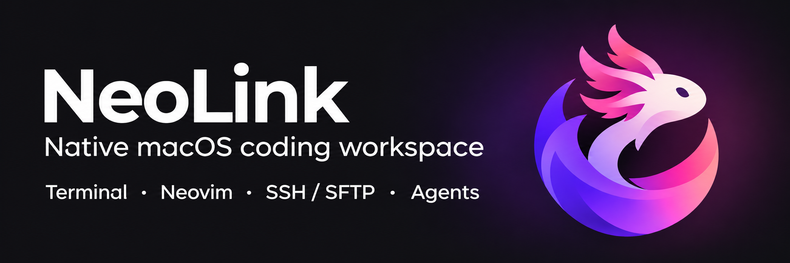
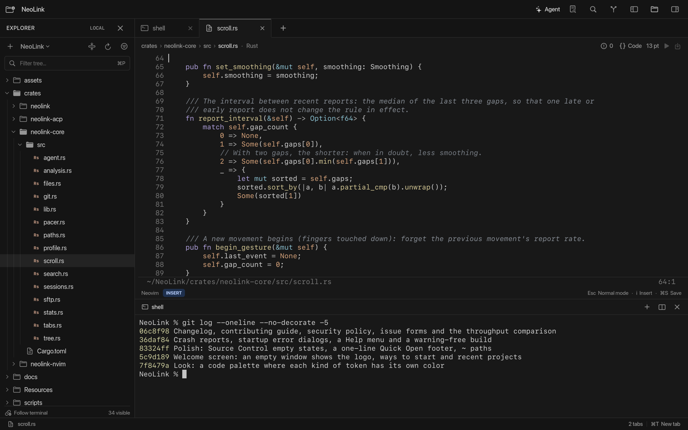

<p align="center">
  
</p>

<h1 align="center">NeoLink</h1>
<p align="center">A fast, GPU-rendered coding workspace: terminals, Neovim, SSH/SFTP, Git and coding agents in one window.</p>

<p align="center">
  
  
  
  
  <a href="https://github.com/abhayasho/NeoLink/actions/workflows/ci.yml"></a>
</p>

<p align="center">
  
</p>

**NeoLink** puts tabbed local and SSH terminals, a Neovim-powered code editor, a project explorer with Git, and coding agents side by side. It draws everything itself on the GPU and presents a frame only when something changed, so it stays responsive while busy and uses no CPU while idle.

NeoLink 2.0 is a ground-up rewrite in Rust that runs on **macOS and Windows**. Versions 1.x were a Swift app for macOS only; that code is kept at the [`swift-final`](https://github.com/abhayasho/NeoLink/tree/swift-final) tag.

## Download

**macOS** (Apple silicon, macOS 13+): **[NeoLink-macos-arm64.zip](https://github.com/abhayasho/NeoLink/releases/latest/download/NeoLink-macos-arm64.zip)**. Unzip and drag **NeoLink.app** to Applications, or quit NeoLink and run:

```bash
curl -fsSL https://raw.githubusercontent.com/abhayasho/NeoLink/main/scripts/install.sh | bash
```

The installer checks the download's SHA-256 and signature, installs to `/Applications` (or `~/Applications`), keeps the previous app as a backup, and updates an existing NeoLink, including 1.x. [Read it first](scripts/install.sh) if you like.

**Windows** (x64, Windows 10+): **[NeoLink-windows-x64.zip](https://github.com/abhayasho/NeoLink/releases/latest/download/NeoLink-windows-x64.zip)**. Extract the whole folder and run `NeoLink.exe`.

Neither build is notarized or code-signed by a certificate authority yet. macOS may ask you to allow the first launch in **System Settings → Privacy & Security** ([Apple's instructions](https://support.apple.com/en-us/102445)); Windows SmartScreen may ask the same.

Optional tools, installed separately: [Neovim](https://neovim.io) 0.11+ for the code editor (without it, files open in a built-in text editor), `ripgrep` for Find in Files, Git, language servers, and coding-agent CLIs. On macOS:

```bash
brew install neovim ripgrep
brew install pyright typescript typescript-language-server   # optional language servers
```

## Features

- **Terminals.** Local shells and SSH sessions in tabs that keep running while you switch; pixel-smooth trackpad scrolling, including inside full-screen programs like `less` and `vim`; selection, copy and paste; **⌘F** search; the shell's folder in the status bar.
- **Terminal under or beside the code.** **⌃`** docks a terminal panel under the editor, **⌃⇧`** beside it; several shells, resizable.
- **Code editor.** One shared Neovim engine drawn natively, with pixel-smooth scrolling, instant switching between files, syntax highlighting, completion, diagnostics, go to definition, references, rename, code actions, formatting and folding through your installed language servers. **Run** a file or open a REPL from the **Code** menu. Without Neovim, a built-in editor with undo, find and safe saving takes over.
- **Explorer.** Project tree or Folder List, Git colors and badges, error counts from open files, filter, create, rename, Trash, copy paths, drag files in to copy them, **Follow terminal**, and live updates when files change on disk.
- **Command palette.** **⇧⌘P** or **F1** finds any command by a few of its letters and shows its shortcut; on Windows it reaches every command.
- **Search.** **⌘P** fuzzy file search and **⇧⌘F** Find in Files.
- **Source Control.** **⇧⌘G** shows diffs, stages and unstages files, commits, creates and switches branches, and previews stashes, using your Git identity and hooks.
- **SSH and SFTP.** Saved connections with passwords in the Keychain (macOS) or Credential Manager (Windows), and a remote file browser over the SSH tab's own connection: browse, create, rename, delete, upload and download.
- **Coding agents.** Run Claude Code or another CLI agent in a terminal panel, or hold a native ACP conversation with streaming replies, tool previews, permission prompts and modes. [Agent guide](docs/AGENT_GUIDE.md).
- **PDFs** open in tabs on macOS (Apple's PDF view, with page and zoom controls) and in your system viewer on Windows.
- **Accessibility.** Screen readers (VoiceOver, Narrator) can read and operate the toolbar, tabs, file tree and the text of the terminal or editor.
- **Looks after itself.** Remembers your project, recent projects, open files, panel sizes, text size and window position; **Help → Check for Updates** tells you when a new version is out; **View → Performance Monitor** shows frame timing live. If it ever crashes, it keeps a report on your computer and tells you on the next launch; nothing is sent anywhere.

## Keyboard shortcuts

On Windows, use **Ctrl+Shift** where macOS uses **⌘** (Ctrl alone stays with the terminal). In the built-in editor, the usual **Ctrl** shortcuts work.

| Action | macOS |
| --- | --- |
| New terminal tab / close tab | ⌘T / ⌘W |
| Next / previous tab | ⇧⌘] / ⇧⌘[ |
| Open file / open project | ⌘O / ⇧⌘O |
| Command palette (every command) | ⇧⌘P or F1 |
| Quick Open / Find in Files | ⌘P / ⇧⌘F |
| Find in terminal or file | ⌘F |
| Source Control | ⇧⌘G |
| Coding agent / agent panel | ⌃⌘A / ⌃⌘B |
| File browser / connections sidebar | ⇧⌘E or ⌘B / ⌃⌘S |
| New SSH connection | ⇧⌘N |
| Terminal under / beside the code | ⌃` / ⌃⇧` |
| Save, undo, redo | ⌘S, ⌘Z, ⇧⌘Z |
| Text size | ⌘+ / ⌘− / ⌘0 |
| Full screen | ⌃⌘F |

The editor starts in Neovim's Insert mode; **Esc** for Normal mode.

## Performance

Measured on an M2 Max MacBook Pro against VS Code 1.146 with a fresh profile and no extensions, on the same folder and file:

| | NeoLink (app, Neovim and shell) | VS Code |
| --- | --- | --- |
| Memory (physical footprint) | 112–115 MiB | 849–1,299 MiB |
| CPU while idle, a minute after launch | 0.0% | 5.7% |
| Terminal output: 1,000,000 lines (77 MiB) written to the terminal | 0.63–0.64 s (121–123 MiB/s) | 7.86–7.99 s (9.7–9.8 MiB/s) |

That is about **12× faster terminal output** (92% less time), with **86–91% less memory**. Memory and CPU: [compare-editors.py](scripts/compare-editors.py); output: [compare-terminal-throughput.sh](scripts/compare-terminal-throughput.sh), three alternating runs each, 10,000 lines of scrollback in both, at each app's default window size (127×41 and 108×55 cells). The output test times how fast the terminal takes the text in, not when the last frame reaches the screen.

NeoLink's own benchmark (`NEOLINK_BENCHMARK`, synthetic input with real timestamps, release build, full screen) measured about 5–7 ms from key press to the frame on screen while macOS presents the window directly (when it composites, every app gains about two refreshes), and steady trackpad scrolling with 1–4 uneven frames in about 300 for the terminal, the editor and full-screen programs; fast flicks are less even. Details, method and raw numbers: [docs/PLAN.md](docs/PLAN.md) and [docs/HORIZONTAL_SCROLL.md](docs/HORIZONTAL_SCROLL.md). Typing latency was not compared with VS Code.

## Build from source

Requires [Rust](https://rustup.rs) (stable).

```bash
git clone https://github.com/abhayasho/NeoLink.git
cd NeoLink
cargo run --release -p neolink -- /path/to/project   # run from the source tree
scripts/build-app.sh                                  # macOS: target/NeoLink.app
python scripts/package-windows.py                     # Windows, after cargo build --release
```

Tests: `cargo test --workspace` (the editor tests use a real Neovim when it is installed), plus `python3 scripts/test-editor.py` for the editor's Lua runtime. [Contributing](CONTRIBUTING.md) · [Changelog](CHANGELOG.md) · [Security](SECURITY.md) · [Releasing](docs/RELEASING.md).

## How it is built

```
crates/
├── neolink/        the app: window and input (winit), GPU renderer (wgpu: Metal; Direct3D 12 or Vulkan),
│                   terminal (alacritty_terminal), editor client, explorer, panels, sheets
├── neolink-core/   platform-independent logic: scrolling, frame pacing, file tree, Git, search, SFTP
├── neolink-nvim/   Neovim client (msgpack-RPC, ext_linegrid grid model)
└── neolink-acp/    Agent Client Protocol client
Resources/Editor/   neolink.lua, the editor configuration Neovim runs with
scripts/            packaging, installer, tests and measurement tools
docs/               design notes, measurements and history
```

Text is shaped with cosmic-text into a glyph atlas and drawn as instanced quads; rows that did not change are kept on the GPU between frames. A frame is presented only when its content differs from what is on screen.

## License

[MIT](LICENSE) © 2026 Abhay Ashok
