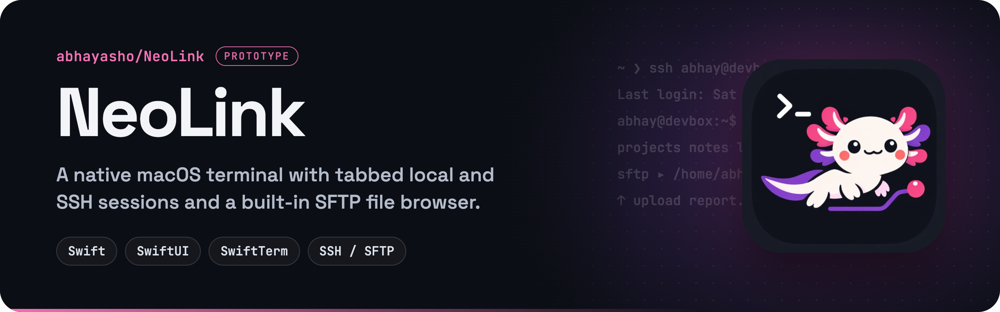

<p align="center">
  
</p>

<p align="center">
  
  
  
  
  
</p>

**NeoLink** is a native macOS terminal that puts tabbed local and SSH sessions next to a file browser, so you can work with local and remote files from one window. I wanted a terminal like this for macOS and couldn't find one I liked, so I started building it.

> [!NOTE]
> NeoLink is an early prototype. Expect rough edges.

## Features

- **Persistent terminal tabs.** Switch between local and SSH sessions without restarting shells or losing scrollback, powered by [SwiftTerm](https://github.com/migueldeicaza/SwiftTerm).
- **Connection sidebar.** Search saved hosts, create a validated SSH connection, or open a local shell in one click.
- **Directory-aware.** Local zsh sessions report their working directory automatically without editing your shell configuration. Each tab keeps its own directory and file browser state.
- **Responsive local browser.** Browse, filter, sort, rename, move to Trash, and drag and drop files while filesystem work runs in the background. Copies preserve existing files by choosing a unique name. Resume **Follow terminal** after browsing manually.
- **Remote SFTP browser.** When you SSH into a host, NeoLink notices and switches the file pane to an SFTP view:
  - browse remote folders, and create, rename or delete entries;
  - upload by dragging files in from Finder;
  - download files and folders from the context menu;
  - reuse connections and stream large transfers without buffering whole files on the UI thread.
- **Keychain storage.** Enter your SFTP password once. NeoLink saves it in the macOS Keychain and reconnects without asking again.
- **Refined workspace.** A dark navy palette with mint accents, native UI typography, monospaced terminal text, resizable file pane, visible tab controls, and keyboard shortcuts.

## Requirements

- macOS 13 Ventura or later
- Xcode 15, or a Swift 5.10+ toolchain

> The package deliberately targets Swift 5.10, because Swift 6's strict concurrency checks conflict with the current version of `swift-ssh-client`.

## Build and run

**From the terminal:**

```bash
git clone https://github.com/abhayasho/NeoLink.git
cd NeoLink
swift build
swift run
```

**As a double-clickable app with an icon:**

```bash
./scripts/build-app.sh
```

This builds a release binary, wraps it in `NeoLink.app` in the project root and embeds the icon from `Resources/AppIcon.png`. Double-click it, or move it to `/Applications`.

## Using NeoLink

| To… | Do this |
| --- | --- |
| Open a local shell | Pick **Local terminal**, click **New terminal**, or press **⌘T** |
| Connect over SSH | Use **+** beside **Connections** or **⇧⌘N** to save a host, then click the connection. You can also run `ssh user@host` in a local tab |
| Browse remote files | Select an SSH tab, then **Connect to files**. Local shell title detection also recognizes remote hosts |
| Upload | Drag files from Finder into the SFTP pane |
| Download | Right-click a remote file and choose download |
| Switch tabs | **⇧⌘]** / **⇧⌘[** |
| Close a tab | Click its **×**, or press **⌘W** |
| Toggle files / connections | **⇧⌘E** / **⌃⌘S** |

## Verify changes

```bash
swift test
```

The regression suite covers isolated tab state, native screen and scrollback retention, shell startup and directory reporting, safe local copies and renames, asynchronous navigation, SSH input validation, and remote path parsing. Tests use temporary files and require no SSH server or credentials. Authenticated SFTP transfers still need an integration check against a server.

## Project layout

```
Sources/
├── Terminal/       SwiftTerm view wrapper
├── Tabs/           tab controller and tabbed terminal view
├── Sessions/       saved sessions, sidebar, persistence
├── FileBrowser/    local file browser pane
├── SFTP/           SFTP manager, connection pool, browser view, Keychain passwords
├── Security/       credential store
└── NeoLinkTheme.swift
```

## Roadmap

- A two-pane layout showing local and remote files together
- Server-side copy and move for remote items
- Better SSH session management: tunnels, jump hosts and more
- Remote desktop sessions (there's a placeholder view for RDP/VNC)
- Eventually, a polished standalone app

## Built with

- [SwiftTerm](https://github.com/migueldeicaza/SwiftTerm) for terminal emulation
- [swift-ssh-client](https://github.com/gaetanzanella/swift-ssh-client) for SSH and SFTP

## License

[MIT](LICENSE) © 2026 Abhay Ashok
