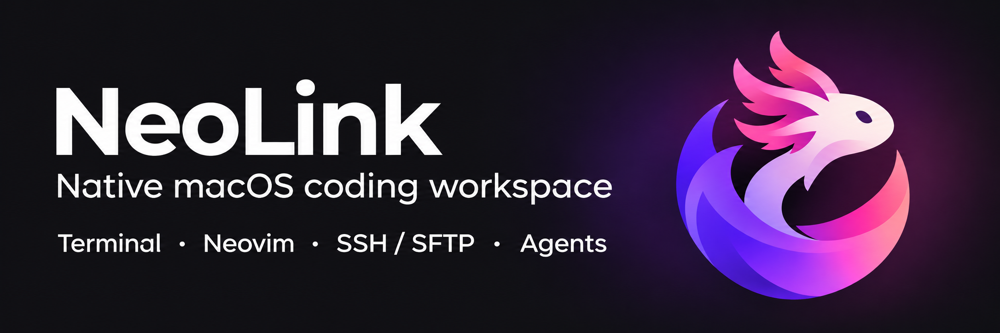

<p align="center">
  
</p>

<p align="center">
  
  
  
  
  
</p>

**NeoLink** is a native macOS coding workspace and terminal that puts tabbed local and SSH sessions next to a file browser, so you can work with local and remote files from one window. I wanted a terminal like this for macOS and couldn't find one I liked, so I started building it.

> [!NOTE]
> NeoLink is an early prototype. Expect rough edges.

## Features

- **Persistent terminal tabs.** Switch between local and SSH sessions without restarting shells or losing scrollback, powered by [SwiftTerm](https://github.com/migueldeicaza/SwiftTerm).
- **Code and PDFs in tabs.** One shared, on-demand Neovim engine provides a dark code editor inside NeoLink. PDFs use a native viewer. Reopening a file selects its existing tab and preserves editing state. A native text editor is available when Neovim is not installed.
- **Code intelligence.** Syntax highlighting, completion, diagnostics, definition, references, hover, rename and code actions use installed language servers. Run supported files in a terminal directly from the code toolbar.
- **Native agent conversations.** Connect an installed ACP adapter from **Agent → Native conversation (ACP)**. Stream replies, inspect tool input and file-change previews, approve or reject requested actions, change advertised modes, and stop a turn in the right panel. Multiple sessions can run alongside code; hiding the panel keeps them alive. Optional stdio MCP server configurations are passed to the adapter. [Setup and limits](docs/AGENT_GUIDE.md).
- **Agent terminals.** Run Claude Code, continue its last project conversation, or launch another installed CLI in a panel or workspace tab. Authentication and terminal-based approvals stay in that CLI. Clean code buffers refresh after agent turns or when editor focus returns; unsaved buffers remain protected.
- **Scrolling and text zoom.** Mouse wheels and trackpads scroll the active Neovim buffer or mouse-aware terminal application. Precise trackpad deltas accumulate instead of jumping on each tiny event. **⌘+**, **⌘−**, **⌘0**, the **View** menu, and the editor's text-size menu adjust code and terminal text. The chosen size is saved across launches; these shortcuts zoom the active PDF instead when it has focus.
- **Native source control.** **⇧⌘G** opens staged/unstaged diffs, file staging and unstaging, commits from the index, local branch creation/switching, and read-only stash previews. Commits use your configured Git identity and hooks. Save editor changes before Git operations; branch switching preserves Git’s normal conflict checks. Push, pull, merge, stash creation/apply, and generated commit messages remain terminal operations.
- **Folding and REPLs.** Use the **Code** menu to fold/unfold code, toggle server-provided inlay hints, or open an installed Python, JavaScript, Swift, Ruby or Lua REPL in the current project.
- **Project tools.** Open a project once and restore its saved folder access on launch. Use **⌘P** to find files and **⇧⌘F** to search their contents. Searches skip dependency/build folders and run only on demand.
- **Safe editing.** Unsaved changes prompt before closing or quitting. Saves preserve encoding and check for external edits. Remote files remain read-only previews. See the [coding workspace guide](docs/CODING_WORKSPACE.md) for limits and recovery behavior.
- **Connection sidebar.** Search saved hosts, create a validated SSH connection, or open a local shell in one click.
- **Directory-aware.** Local zsh sessions report their working directory automatically without editing your shell configuration. Each tab keeps its own directory and file browser state.
- **Responsive local browser.** Create files/folders, browse, filter, sort, rename, move to Trash, and drag and drop files while filesystem work runs in the background. Copies preserve existing files by choosing a unique name. Resume **Follow terminal** after browsing manually.
- **Remote SFTP browser.** When you SSH into a host, NeoLink notices and switches the file pane to an SFTP view:
  - browse remote folders, and create, rename or delete entries;
  - upload by dragging files in from Finder;
  - download files and folders from the context menu;
  - reuse connections and stream large transfers without buffering whole files on the UI thread.
- **Keychain storage.** Enter your SFTP password once. NeoLink saves it in the macOS Keychain and reconnects without asking again.
- **Understated dark workspace.** A compact navigator, flat tabs, a `#141414` navigator, `#181818` editor and agent surfaces, muted blue/pink syntax, subtle gray borders, and a resizable agent panel keep attention on your code. Connections and Explorer share the left navigation area. The native editor fallback uses the same palette.
- **Collapsible panels.** Close Connections or Files/SFTP with **×** and reopen them from the header. Your panel visibility is remembered across launches, while open tabs and saved connections stay available.

## Requirements

- macOS 13 Ventura or later
- Xcode 15, or a Swift 5.10+ toolchain

> The package deliberately targets Swift 5.10, because Swift 6's strict concurrency checks conflict with the current version of `swift-ssh-client`.

## Build and run

**From the terminal:**

```bash
git clone https://github.com/abhayasho/NeoLink.git
cd NeoLink
swift build
swift run
```

**As a double-clickable app with an icon:**

```bash
./scripts/build-app.sh
```

This builds a release binary, wraps it in `NeoLink.app` in the project root and embeds the icon from `Resources/AppIcon.png`. Double-click it, or move it to `/Applications`.

## Coding tools

```bash
brew install neovim ripgrep
# Optional language servers for Python and JavaScript/TypeScript:
brew install pyright typescript-language-server
```

Neovim 0.11+ is required for the coding engine (tested with 0.12.6). Swift and C/C++ language services use `sourcekit-lsp` and `clangd` from the installed toolchain. Servers start only when needed. Without Neovim, text files still open in native tabs; without ripgrep, project search explains how to install it.

For remembered folder access, choose **File → Open Project** once. NeoLink restores the selected folder, retains bookmarks when a drive is temporarily unavailable, and activates other recent folders only when selected. Use the same installed copy in `/Applications` for everyday work.

macOS controls Documents/Desktop/Downloads and local-network permissions separately from NeoLink's project picker. It normally remembers your decision for the same app identity. **Local ad-hoc builds can prompt again after an update** because their signing identity changes; a saved folder bookmark cannot prevent this. For releases, set `NEOLINK_SIGNING_IDENTITY` to a valid Apple-issued signing certificate and keep using the same certificate type, developer team, and bundle identifier. New protected locations or revoked grants may still need approval. [Architecture, benchmarks, permissions and limits](docs/CODING_WORKSPACE.md).

## Coding agents

Open a project and click **Agent** (or **⌃⌘A**). Choose an interface:

- **Terminal** runs `claude`, `claude --continue`, or a custom CLI in a PTY. Sign in and answer its prompts there. Choose a panel or workspace tab.
- **Native conversation (ACP)** runs an ACP-compatible adapter in the right panel. For Claude, install [`claude-agent-acp`](https://github.com/agentclientprotocol/claude-agent-acp) separately, then select **Claude Code**. For another adapter, select **Custom CLI** and its executable. A regular `claude` binary is a terminal application, not an ACP adapter.

Custom arguments are passed literally, one per line. The custom name/executable are remembered; arguments and optional MCP configuration are not saved. NeoLink does not automatically install or start agents. Provider authentication and model configuration belong to the selected CLI/adapter; NeoLink has no API-key store or direct model client.

Agents operate on saved files. Save your editor changes first. Native conversations can explicitly include the active file's path; they do not automatically send editor selections or unsaved text. Tool permission requests require your choice. Closing a native session stops its adapter; hiding the panel keeps it running. Conversations currently last for the app session. See the [agent guide](docs/AGENT_GUIDE.md) for setup, MCP configuration, protocol support, and validation limits.

## Using NeoLink

| To… | Do this |
| --- | --- |
| Open a local shell | Pick **Local terminal**, click the tab-strip **+**, or press **⌘T** |
| Connect over SSH | Use **+** beside **Connections** or **⇧⌘N** to save a host, then click the connection. You can also run `ssh user@host` in a local tab |
| Browse remote files | Select an SSH tab, then **Connect to files**. Local shell title detection also recognizes remote hosts |
| Upload | Drag files from Finder into the SFTP pane |
| Download | Right-click a remote file and choose download |
| Open code or a PDF | Click it in the file browser, or use **⌘O** for a local file |
| Save local code/text edits | **⌘S** or **Save**; Neovim `:saveas filename` or native **Save Copy…** preserves a separate copy |
| Open / remember a project | **⇧⌘O** |
| Create a file or folder | **+** in the file pane, or right-click a local folder |
| Find a file / search project text | **⌘P** / **⇧⌘F** |
| Code completion | **Control-Space**, or server-provided automatic triggers |
| Launch a coding agent | **Agent** in the header or **⌃⌘A**; choose a project and interface |
| Hide / reopen agent panel | **⌃⌘B**, or the right-sidebar button; sessions keep running |
| Change text size | **⌘+** / **⌘−** / **⌘0**, **View**, or the editor's **pt** menu |
| Review / stage / commit Git changes | **⇧⌘G**, or the branch icon in the header |
| Fold code / toggle inlay hints | **Code** menu or editor toolbar's **Code** menu |
| Start an interactive interpreter | **Code → Open REPL** |
| Definition, rename, references | Use the **Code** menu or editor toolbar |
| Neovim editing modes | Starts in Insert; **Esc** for Normal; **i** to insert |
| Find text in the editor | **⌘F** |
| Use an external application | Right-click a local file and choose **Open in Default App** |
| Switch tabs | **⇧⌘]** / **⇧⌘[** |
| Close a tab | Click its **×**, or press **⌘W** |
| Close files / connections | Click the panel's **×**; reopen it with the **folder** / **sidebar** buttons in the workspace header, or **⇧⌘E** / **⌃⌘S**. Visibility is remembered across launches |
| Move the window | Drag an empty part of the **Workspace** header |
| Close / minimize / full screen | Use the standard red, yellow, and green window buttons, or **⇧⌘W** / **⌘M** / **⌃⌘F** |

## Verify changes

```bash
swift test
python3 scripts/test-editor.py
```

The regression suite covers wheel-delta accumulation, persisted text sizing, docked-agent lifecycle, Git staging/unstaging and commits (including an unborn repository), local branch conflicts, stash previews, literal filenames, ACP streaming/permissions/cancellation/timeouts and parallel session isolation, isolated tab state, native screen and scrollback retention, document deduplication, editor undo, PDF page retention, encoding-preserving saves and external-edit conflicts, shell startup and directory reporting, agent argument quoting and project selection, clean-buffer reloads, bookmark recovery after temporary failures, safe local copies and renames, asynchronous navigation, SSH input validation, and remote path parsing. Tests use temporary files and require no SSH server or credentials. Authenticated SFTP transfers and remote previews still need an integration check against a server.

## Project layout

```
Sources/
├── Terminal/       SwiftTerm view wrapper
├── Tabs/           tab controller and tabbed terminal view
├── Documents/      Neovim bridge, native text fallback, PDF viewer, file IO
├── Workspace/      remembered project access and bounded project search
├── Agents/         ACP transport/conversations and terminal agent launcher
├── Tools/          cancellable subprocess runner
├── Sessions/       saved sessions, sidebar, persistence
├── FileBrowser/    local file browser pane
├── SFTP/           SFTP manager, connection pool, browser view, Keychain passwords
├── Security/       credential store
└── NeoLinkTheme.swift
```

## Roadmap

The [feature plan](docs/FEATURE_PLAN.md) distinguishes shipped native tools from larger planned features, including debugging, editable multi-file excerpts, edit prediction, and an extension system. NeoLink does not claim feature parity or a measured speed advantage over established IDEs.

- A two-pane layout showing local and remote files together
- Server-side copy and move for remote items
- Better SSH session management: tunnels, jump hosts and more
- Remote desktop sessions (there's a placeholder view for RDP/VNC)
- Eventually, a polished standalone app

## Built with

- [Neovim](https://neovim.io) for the embedded coding engine
- [SwiftTerm](https://github.com/migueldeicaza/SwiftTerm) for terminal emulation
- [swift-ssh-client](https://github.com/gaetanzanella/swift-ssh-client) for SSH and SFTP

## License

[MIT](LICENSE) © 2026 Abhay Ashok
