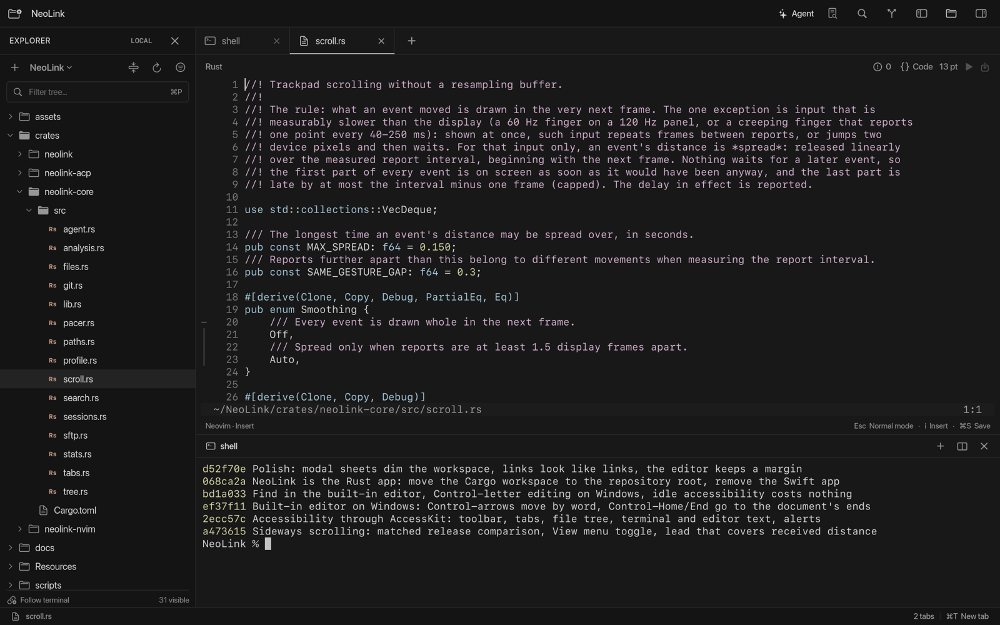

NeoLink 2.0 is a ground-up rewrite in Rust. It runs on **macOS and Windows**, draws everything on the GPU, and presents a frame only when something changed.



**New in 2.0**

- **Windows** (x64): extract `NeoLink-windows-x64.zip` and run `NeoLink.exe`.
- **Terminal under or beside the code:** ⌃` docks a terminal under the editor, ⌃⇧` beside it.
- **Smooth scrolling inside full-screen programs** such as `less` and `vim`, alongside pixel-smooth terminal, editor and explorer scrolling.
- **Lighter:** about 115 MiB of memory with Neovim and a shell running, and 0% CPU while idle (VS Code 1.146 with no extensions: 849–1,299 MiB and 5.7% on the same project).
- **Built-in text editor** with undo, find and safe saving when Neovim is not installed.
- **Screen-reader support** through AccessKit (VoiceOver, Narrator) for the toolbar, tabs, file tree and terminal/editor text.
- **Preview:** View → Pixel-Smooth Sideways Scrolling.

Everything from 1.x carries over: tabbed local and SSH terminals, the Neovim editor with language servers, explorer with Git, Quick Open and Find in Files, Source Control, SFTP browser, saved SSH passwords, coding agents (terminal and ACP), and PDF tabs on macOS.

**Install or update**

macOS (Apple silicon, macOS 13+): quit NeoLink, then run

```bash
curl -fsSL https://raw.githubusercontent.com/abhayasho/NeoLink/main/scripts/install.sh | bash
```

or download **NeoLink-macos-arm64.zip** and drag the app to Applications. The installer replaces NeoLink 1.x and keeps it in a backup folder.

Windows (x64, Windows 10+): download **NeoLink-windows-x64.zip**, extract the folder, run `NeoLink.exe`.

Optional: Neovim 0.11+ (`brew install neovim`), ripgrep, Git, language servers and agent CLIs.

**Upgrading from 1.x**

- Saved SSH connections and passwords carry over. Window layout, panel sizes and text size start from defaults once.
- macOS may ask again for access to Documents, Desktop or Downloads, and for the first launch (the app is ad-hoc signed, not notarized; see [Apple's instructions](https://support.apple.com/en-us/102445)). Windows SmartScreen may ask too.
- Not in 2.0 yet: input methods (IME) for languages such as Chinese, Japanese and Korean; PDF tabs on Windows (PDFs open in the system viewer); Intel Macs (build from source). [Full status](https://github.com/abhayasho/NeoLink/blob/main/docs/STATUS.md).

The Swift source of 1.x is kept at the [`swift-final`](https://github.com/abhayasho/NeoLink/tree/swift-final) tag.
