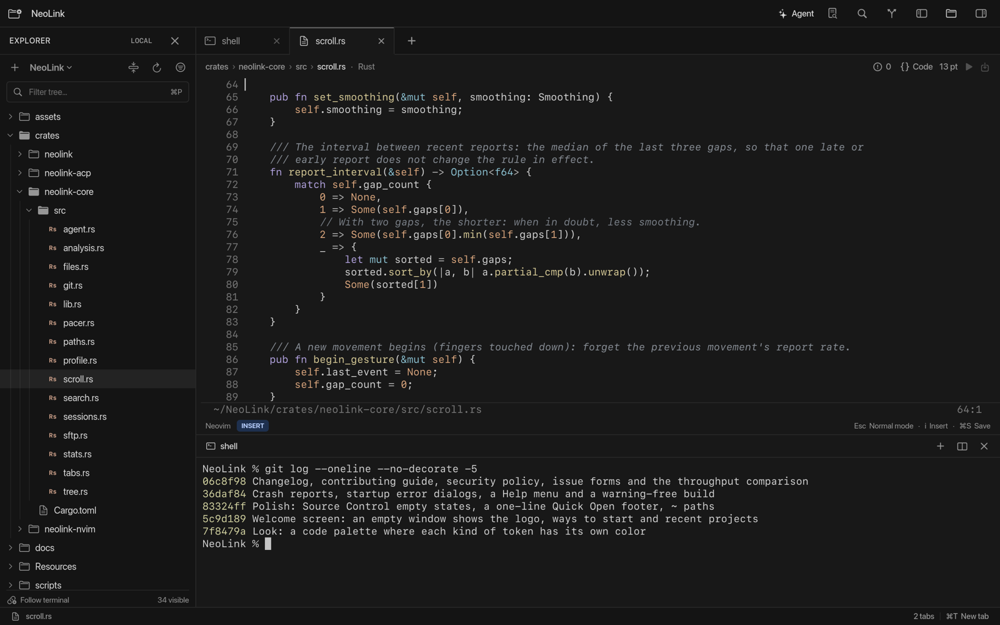

A polish and production-readiness release.



- **New code colors.** Each kind of token has its own color: keywords, types, functions, strings, numbers, attributes and macros, properties, parameters and operators, with italic comments.
- **Welcome screen.** A window with no tabs shows ways to start (new terminal, open project, Quick Open, Find in Files, coding agent) with their shortcuts, and your recent projects. Closing the last tab, or its shell exiting, no longer quits NeoLink; ⌘W on the welcome screen closes the window.
- **Source Control** shows clear placeholders when the tree is clean or no file is selected, and its button reads *Commit* until files are staged.
- **Quick Open's** notes share one tidy line; the agent launcher shows the project folder as `~/…`.
- **Crash reports.** If NeoLink crashes, it saves a report on your computer (`~/Library/Logs/NeoLink`, or `%LOCALAPPDATA%\NeoLink\Logs` on Windows) and tells you on the next launch. Nothing is sent anywhere.
- **Clear startup errors.** A missing GPU or display problem now shows a dialog that explains it instead of exiting silently.
- **Help menu** (macOS): Report an Issue, Release Notes and Show Crash Reports.

**Faster than VS Code's terminal.** Writing 1,000,000 lines (77 MiB) to the terminal took 0.63–0.64 s in NeoLink and 7.86–7.99 s in VS Code 1.146, about 12× faster, measured with the new `scripts/compare-terminal-throughput.sh`. NeoLink also used 86–91% less memory and no CPU while idle.

**Install or update**

macOS (Apple silicon, macOS 13+): quit NeoLink, then run

```bash
curl -fsSL https://raw.githubusercontent.com/abhayasho/NeoLink/main/scripts/install.sh | bash
```

or download **NeoLink-macos-arm64.zip** and drag the app to Applications. Windows (x64): download **NeoLink-windows-x64.zip**, extract the folder and run `NeoLink.exe`.

The app is ad-hoc signed and not notarized; macOS may ask you to allow the first launch ([Apple's instructions](https://support.apple.com/en-us/102445)), and Windows SmartScreen may ask too.
